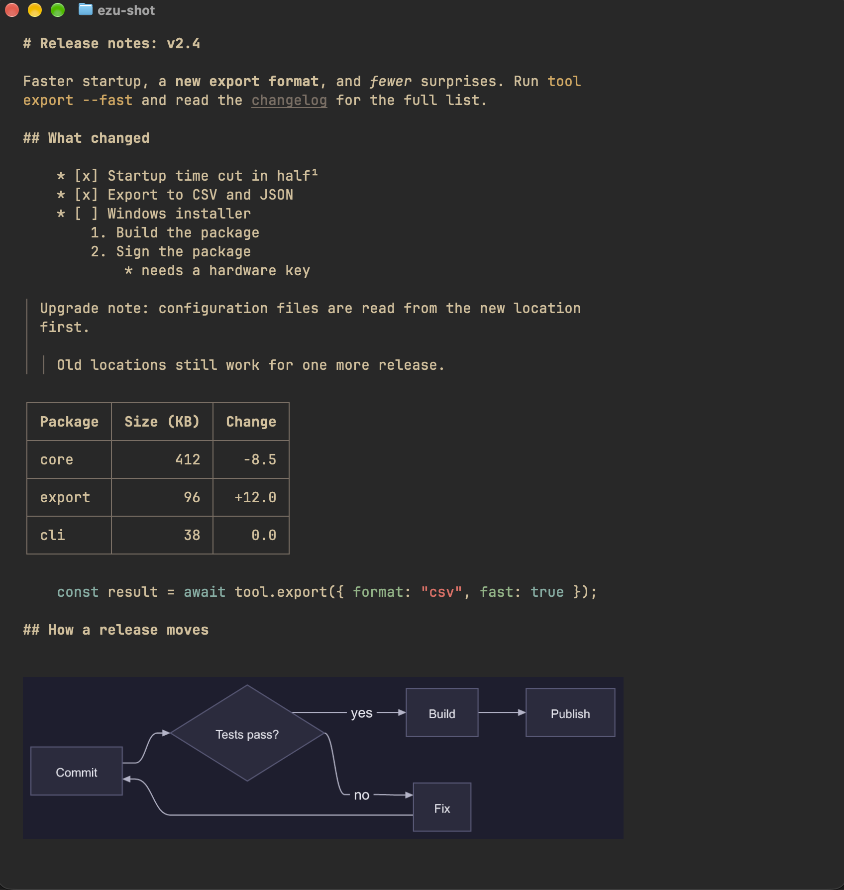
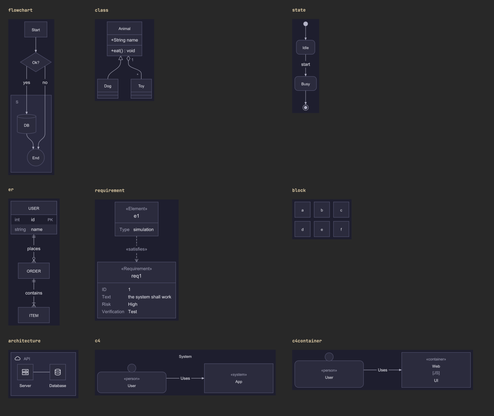
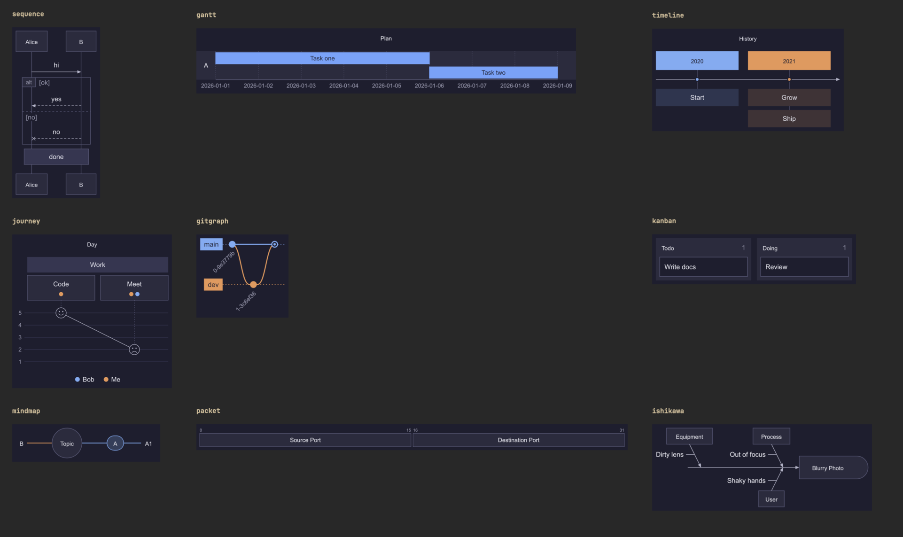
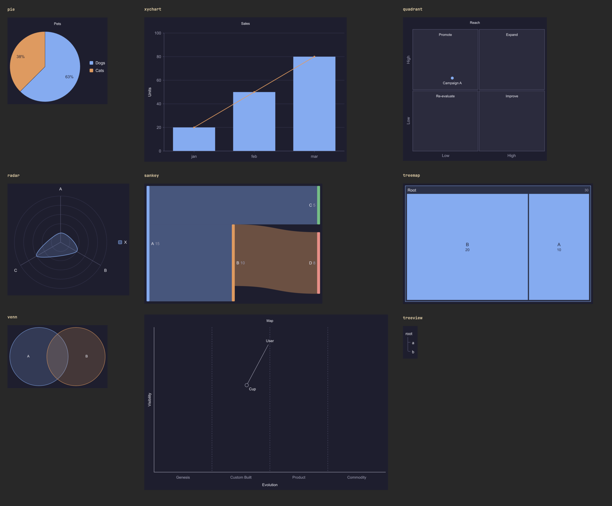

# ezu

**Read Markdown and Mermaid diagrams in your terminal. Text is wrapped to the window, diagrams are drawn as images.**

<p align="center">
  
</p>

- **Full Markdown.** Headings, emphasis, nested and ordered lists, task lists, block quotes, tables, code blocks, footnotes, rules, images and links.
- **Every Mermaid diagram type.** Fenced <code>```mermaid</code> blocks are drawn with [pele](https://github.com/obsidianmd/pele) and shown inline through the kitty graphics protocol, scaled to the terminal width.
- **CJK-aware layout.** Lines wrap by display width, wide characters never split, tables stay aligned.
- **Clickable links.** Links are real terminal hyperlinks (OSC 8).
- **Detects the terminal.** ezu asks the terminal whether it supports kitty graphics and what its background colour is, then picks a matching theme. Without graphics it prints a note and the Mermaid source, and image alt text.
- **Safe on untrusted files.** See [Security](#security).

<p align="center">
  
  
  
</p>

<sub>All four images are real screenshots of ezu running in Ghostty. The first is <code>ezu demo/demo.md</code>. The three galleries show one sample per diagram type, each captured from its own Ghostty window; <code>./screenshots.sh</code> (macOS, Ghostty and ImageMagick) rebuilds them. The content is invented.</sub>

## Supported syntax

**Mermaid:** flowchart, sequence, class, state, er, gantt, pie, quadrant, requirement, gitgraph, c4 (context and container), mindmap, timeline, sankey, xychart, block, packet, kanban, architecture, radar, treemap, journey, venn, wardley, treeview, ishikawa. Front matter, `%%{init}` directives, comments, `classDef`, `linkStyle`, markdown strings and Font Awesome icons are covered by tests.

**Markdown:** ATX and setext headings, bold, italic, strikethrough, inline code, fenced and indented code with highlighting, ordered lists (honoring the start number), bullet and task lists with nesting, block quotes with nesting, tables with per-column alignment (numeric columns right-aligned), horizontal rules, footnotes (shown as superscripts with a numbered list at the end), inline HTML (tags stripped, `<br>` kept as a line break), hard and soft line breaks, links, autolinks, and images.

Details worth knowing:

- Mermaid blocks inside lists and block quotes are drawn too.
- A diagram that fails to parse shows a one-line error and its source; the rest of the document renders normally.
- Local images (PNG and SVG) are shown inline; images that are missing, remote or outside the document's folder fall back to their alt text.
- Footnote and link text keep their inline formatting.

## Security

Documents are treated as untrusted:

- SVG from diagrams and images is parsed, checked and re-serialized before rendering. External references (`http`, `file`, relative paths, `feImage`, entities, `DOCTYPE`) are rejected or neutralized, and rendering runs in an empty temporary directory.
- Image paths must resolve (after symlinks) inside the document's folder. Reads are non-blocking, so a FIFO cannot hang the program, and size and pixel limits apply.
- Only `http`, `https` and `mailto` links become hyperlinks, and terminal escape sequences in the source are removed.

## Limitations

- Diagrams and images need a kitty-graphics terminal. Ghostty is the only one tested; the detection query is not verified on other terminals.
- Detection needs a terminal on stdin. When Markdown comes from a pipe, ezu uses the environment hints and the dark theme.
- Mermaid support is whatever pele supports: every diagram type built into Mermaid 12.1.0, plus the newer types listed above. ZenUML is an external Mermaid package and is not supported.
- Not published to npm; install from a clone.

## Development

```sh
./test.sh    # end-to-end tests, ends with ALL GREEN or RED
```

`test.sh` runs `test-syntax.sh` as its last step. Artifacts from each run are written to `out/` (git-ignored).
