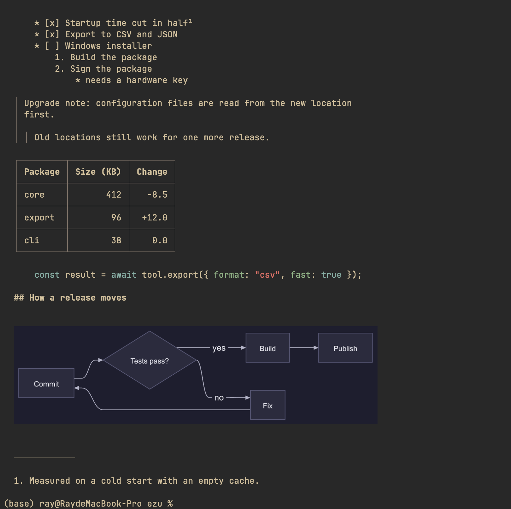

# ezu

**Read Markdown and Mermaid diagrams in your terminal. Text is wrapped to the window, diagrams are drawn as images.**

<p align="center">
  
</p>

- **Full Markdown.** Headings, emphasis, nested and ordered lists, task lists, block quotes, tables, code blocks, footnotes, rules, images and links.
- **Every Mermaid diagram type.** Fenced <code>```mermaid</code> blocks are drawn with [pele](https://github.com/obsidianmd/pele) and shown inline through the kitty graphics protocol, scaled to the terminal width.
- **CJK-aware layout.** Lines wrap by display width, wide characters never split, tables stay aligned.
- **Clickable links.** Links are real terminal hyperlinks (OSC 8).
- **Detects the terminal.** ezu asks the terminal whether it supports kitty graphics and what its background colour is, then picks a matching theme. Without graphics it prints a note and the Mermaid source, and image alt text.
- **Safe on untrusted files.** See [Security](#security).

<p align="center">
  
</p>

<sub>Both images are real screenshots of ezu running in Ghostty. The first is <code>ezu demo/demo.md</code>. In the second, each diagram type was captured in its own window and the nine captures were arranged into one image. The content is invented.</sub>

## Install

Requires Node 24.2 or newer. Diagrams and images need a terminal that supports the kitty graphics protocol (tested in Ghostty). Other terminals get plain text.

```sh
git clone https://github.com/Ray0907/ezu && cd ezu
npm install
npm link        # puts `ezu` on your PATH
```

Fonts for diagram text are read from `/System/Library/Fonts/Supplemental/` and `/Library/Fonts/` (macOS). Elsewhere the system fonts are used, which is slower to start.

## Usage

```sh
ezu notes.md              # Markdown file
ezu diagram.mmd           # a single Mermaid diagram
cat notes.md | ezu --md   # stdin; --md forces Markdown
ezu --light notes.md      # light diagram theme
ezu -w 60 notes.md        # wrap text at 60 columns
ezu --png out.png diagram.mmd   # write a PNG instead of drawing
```

| Flag | Effect |
| --- | --- |
| `--light` | Light theme for diagrams. |
| `--dark` | Dark theme for diagrams. |
| `--md` | Treat input as Markdown. Files ending in `.md` or `.markdown` are Markdown already. |
| `--width N`, `-w N` | Content width in columns for Markdown wrapping. Default is the smaller of the terminal width minus margins and 70. `0` uses the full terminal width minus margins. A value that is not a whole number of at least 0 prints `ezu: invalid width` and exits 1. |
| `--png out.png` | Write the diagram as a PNG file. |

With neither `--light` nor `--dark`, ezu reads the terminal background (OSC 11) and picks the light theme when the background is light. If the terminal does not answer, the theme is dark.

If you give no file and stdin is a terminal, ezu prints a usage line to stderr and exits 1.

Output is wrapped to the terminal width (80 columns when piped). Diagram size is measured from the terminal's cell size, so images match the text width.

### Terminal detection

When stdin and stdout are both terminals, ezu sends one query and waits up to about 150 ms for the answer. The query asks for the cell size, the background colour and kitty graphics support. If the terminal does not answer, ezu uses environment hints: `KITTY_WINDOW_ID`, `TERM_PROGRAM` set to `ghostty`, `kitty` or `WezTerm`, or `TERM` that contains `kitty` or `ghostty`.

### Environment variables

| Variable | Effect |
| --- | --- |
| `EZU_GRAPHICS=on` | Always use graphics, hyperlinks and local images, even when output is piped or the terminal does not report support. |
| `EZU_GRAPHICS=off` | Never use graphics. |

### When output is piped

When stdout is not a terminal, Markdown output is plain text. It has no graphics sequences and no hyperlink sequences. Links print as `text (url)`, images print as their alt text, and a Mermaid block prints as a dimmed one-line note followed by its source. `EZU_GRAPHICS=on` turns the rich output back on. A single diagram that is not Markdown still writes PNG bytes to a pipe.

## Supported syntax

**Mermaid:** flowchart, sequence, class, state, er, gantt, pie, quadrant, requirement, gitgraph, c4, mindmap, timeline, sankey, xychart, block, packet, kanban, architecture, radar, treemap, journey. Front matter, `%%{init}` directives, comments, `classDef`, `linkStyle`, markdown strings and Font Awesome icons are covered by tests.

**Markdown:** ATX and setext headings, bold, italic, strikethrough, inline code, fenced and indented code with highlighting, ordered lists (honoring the start number), bullet and task lists with nesting, block quotes with nesting, tables with per-column alignment (numeric columns right-aligned), horizontal rules, footnotes (shown as superscripts with a numbered list at the end), inline HTML (tags stripped, `<br>` kept as a line break), hard and soft line breaks, links, autolinks, and images.

Details worth knowing:

- Mermaid blocks inside lists and block quotes are drawn too.
- A diagram that fails to parse shows a one-line error and its source; the rest of the document renders normally.
- Local images (PNG and SVG) are shown inline; images that are missing, remote or outside the document's folder fall back to their alt text.
- Footnote and link text keep their inline formatting.

## Security

Documents are treated as untrusted:

- SVG from diagrams and images is parsed, checked and re-serialized before rendering. External references (`http`, `file`, relative paths, `feImage`, entities, `DOCTYPE`) are rejected or neutralized, and rendering runs in an empty temporary directory.
- Image paths must resolve (after symlinks) inside the document's folder. Reads are non-blocking, so a FIFO cannot hang the program, and size and pixel limits apply.
- Only `http`, `https` and `mailto` links become hyperlinks, and terminal escape sequences in the source are removed.

## Limitations

- Diagrams and images need a kitty-graphics terminal. Ghostty is the only one tested; the detection query is not verified on other terminals.
- Detection needs a terminal on stdin. When Markdown comes from a pipe, ezu uses the environment hints and the dark theme.
- Mermaid support is whatever pele supports: every diagram type built into Mermaid 12.1.0. Newer types may render as a different diagram or not at all.
- Not published to npm; install from a clone.

## Development

```sh
./test.sh    # end-to-end tests, ends with ALL GREEN or RED
```

`test.sh` runs `test-syntax.sh` as its last step. Artifacts from each run are written to `out/` (git-ignored).
