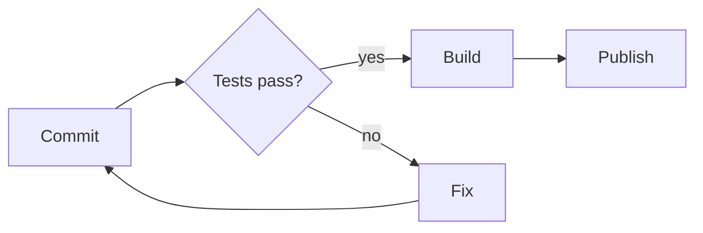

# Release notes: v2.4

Faster startup, a **new export format**, and *fewer* surprises. Run `tool export --fast`
and read the [changelog](https://example.com/changelog) for the full list.

## What changed

- [x] Startup time cut in half[^1]
- [x] Export to CSV and JSON
- [ ] Windows installer
  1. Build the package
  2. Sign the package
     - needs a hardware key

> Upgrade note: configuration files are read from the new location first.
> > Old locations still work for one more release.

| Package | Size (KB) | Change |
|:--------|----------:|-------:|
| core    |       412 |   -8.5 |
| export  |        96 |  +12.0 |
| cli     |        38 |    0.0 |

```js
const result = await tool.export({ format: "csv", fast: true });
```

## How a release moves



[^1]: Measured on a cold start with an empty cache.
